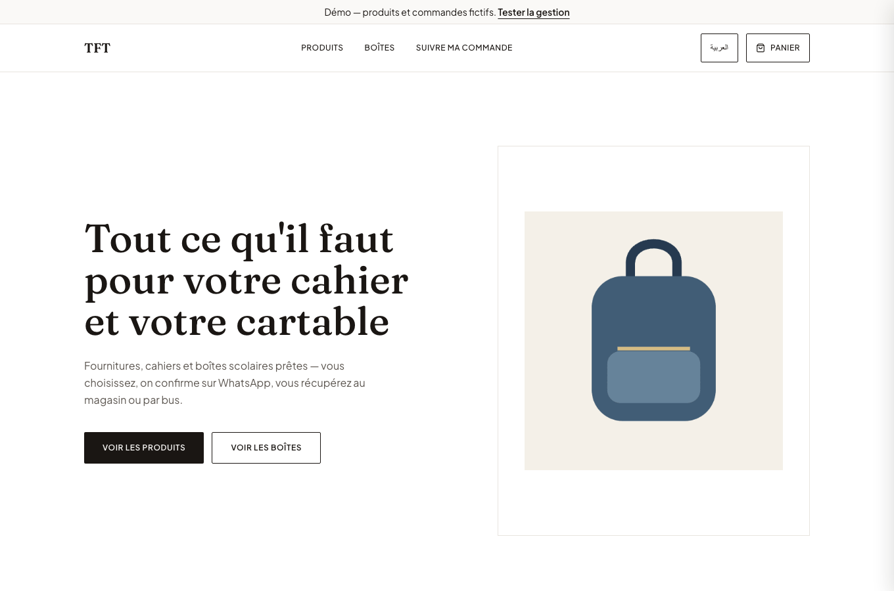
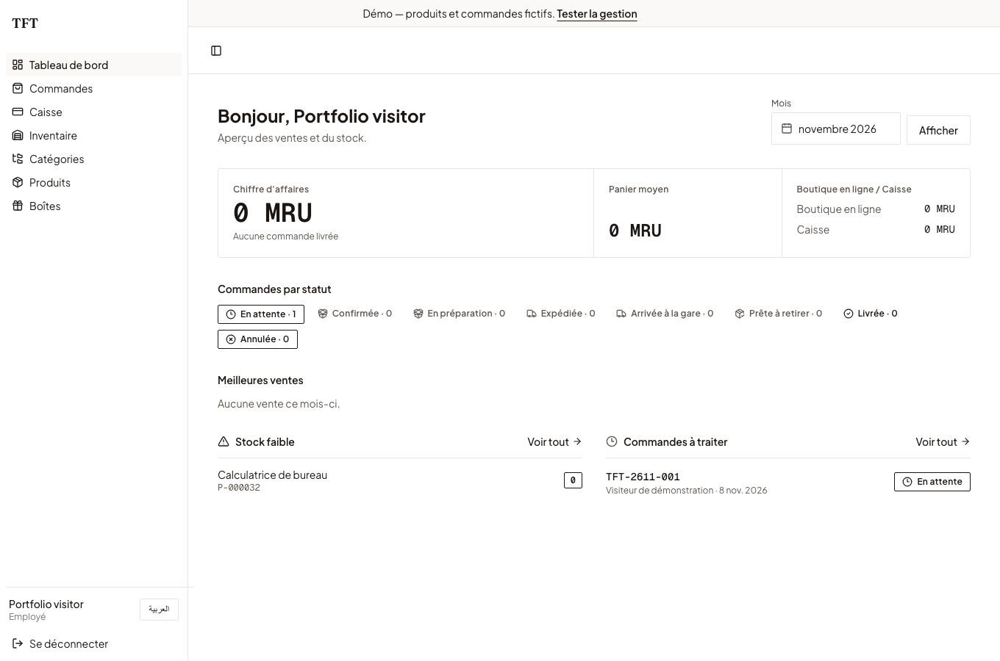

# TFT — The First Trade

A bilingual Arabic/French storefront and shop-management application for a Mauritanian stationery retailer. Customers browse and place orders without creating an account; staff use the same catalog, pricing, and stock through a barcode-driven point of sale.

## Try it

**[Live portfolio demo](https://tft-portfolio-demo.vercel.app)** · **[Demo management console](https://tft-portfolio-demo.vercel.app/fr/admin/login)**

The demo uses a separate Neon database with fictional products and orders. No payment is collected or real order fulfilled. Please use fictional customer details. Demo activity is shared between visitors and may be reset.

Demo operator: `demo@tft.example` / `Explore-TFT-2026!`

This deliberately public account can explore sales, orders, inventory, and the dashboard. It cannot manage accounts, change shop settings, or upload/delete product media. These credentials belong only to the demo, never to the real shop.





## What the code demonstrates

- Arabic-first RTL and French interfaces with `next-intl`.
- A storefront, product variants, bundles, promotions, checkout, and order tracking.
- Shared integer-MRU pricing across online and in-shop sales; checkout recalculates prices server-side.
- Barcode POS, stock movements, and an auditable order lifecycle.
- Transactional stock updates and idempotency keys for retried submissions.
- Server-side role/permission checks for staff and administrators.
- Database-backed regression tests for permissions, pricing, order transitions, and inventory.

Next.js 16 and React 19 own the interface and server actions. Drizzle models PostgreSQL on Neon. Ordinary reads use Neon's HTTP driver; multi-step sales and stock operations use database transactions over WebSockets. Cloudinary serves product media. Better Auth handles staff sessions. Deployments run on Vercel in Frankfurt, near the existing Neon database.

`src/services/stock-transactions.ts` contains the stock primitives shared by POS and order orchestration. `src/services/pricing.ts` is the pricing entry point. `src/services/authz.ts` and `src/lib/permissions.ts` define the access boundary. The project was built with AI assistance; domain rules and regression tests make the resulting behavior reviewable.

## Run locally

Requires Node.js 24+, npm, your own Neon development database, and Cloudinary credentials.

```bash
npm ci
cp .env.example .env
```

Fill in the required values. Generate `BETTER_AUTH_SECRET` with `openssl rand -hex 32`. Optional monitoring, WhatsApp, and site URL values may stay blank. To apply migrations and start the app:

```bash
node --env-file=.env node_modules/drizzle-kit/bin.cjs migrate
npm run dev
```

For fictional seed data, configure `SEED_ADMIN_EMAIL` and a private `SEED_ADMIN_PASSWORD`. Set `ALLOW_DESTRUCTIVE_SEED=true` only against a disposable database, then run `npm run db:seed`. **Seeding deletes existing catalog and order records.** The script refuses production environments and requires explicit opt-in.

## Verify

```bash
npm run lint
npm run typecheck
npm run test:unit
npm run build
```

Integration tests require a **separate disposable Neon database**, with all migrations applied. Put `TEST_DATABASE_URL` and the other required development environment values in an ignored `.env.test`, then run `npm test`. The suite writes and deletes records; it will not silently fall back to the application's `.env` database. GitHub CI runs lint, type checks, and unit tests without production credentials.

## Repository map

| Path | Responsibility |
| --- | --- |
| `app/`, `components/` | Storefront, management interface, server routes |
| `src/services/` | Pricing, inventory, orders, POS, authorization |
| `src/db/schema/`, `src/db/migrations/` | Database model and migration history |
| `src/db/seed*.ts` | Fictional development catalog and account setup |
| `src/lib/` | Validation, integrations, and shared domain helpers |
| `tests/` | Unit and database-backed regression coverage |
| `messages/` | Arabic and French translations |

## Scope

Payments and delivery arrangements happen outside the application; the portfolio demo does not contact the real shop. The in-memory rate limiter is per server instance, so a real deployment also needs an edge or shared rate limit. Performance targets are not published benchmarks. Customer exports, credentials, and database dumps must remain outside Git.

No source license has been selected. Third-party assets retain their own terms; the vendored shadcn CSS license is included in `src/styles/shadcn.LICENSE`.
